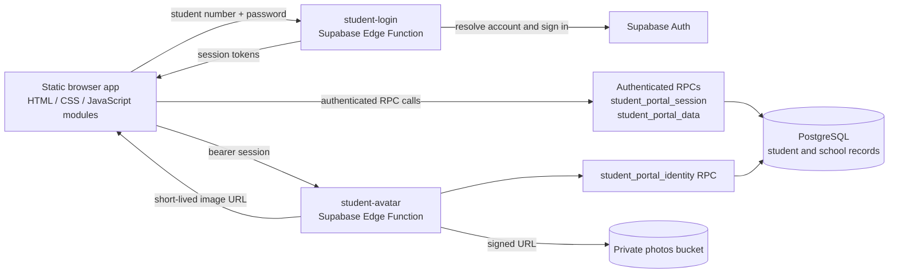

# Pioneers of Science School


An Arabic, right-to-left school website with a public information landing page and a student portal backed by Supabase. The browser application is built with native HTML, CSS, and JavaScript modules; it has no checked-in framework, package manifest, or build step.

> **Implementation status:** The front end, SQL migrations, and Supabase Edge Functions are present in the repository. A live Supabase deployment and end-to-end authentication/data access have not been verified.

## Contents

- [Overview](#overview)
- [Features and boundaries](#features-and-boundaries)
- [Architecture](#architecture)
- [Technology](#technology)
- [Run locally](#run-locally)
- [Configure Supabase](#configure-supabase)
- [Tests](#tests)
- [Repository map](#repository-map)
- [Security and limitations](#security-and-limitations)
- [Project documentation](#project-documentation)

## Overview

The project presents the school and its learning stages, then provides an authenticated student space for personal enrollment information and school records. Student data is requested through authenticated Supabase RPC functions rather than direct browser queries to the student and finance tables.

The repository also contains a broader school-information schema and server-side staff/student account-management functions. It does **not** contain a visible staff administration application that consumes those management endpoints.

## Features and boundaries

| Area | What the repository implements | Verification boundary |
| --- | --- | --- |
| Public site | Arabic school information, stages, portal overview, FAQ, and contact links | Implemented in the static front end; no browser automation is included |
| Student sign-in | Student number and password form; `student-login` Edge Function resolves the student account and returns an Auth session | Source is present; live Supabase sign-in is unverified |
| Student portal | Summary, profile, attendance, approved results, fees, timetable, and an educational-links page | UI and data projection are present; live data is unverified; educational links currently map to an empty list |
| Session behavior | Restore a saved session, confirm linked student identity, navigate by portal page, and sign out | Source is present; browser/Auth integration is unverified |
| Student portrait | Optional private photo retrieval through a short-lived signed Storage URL, with local artwork fallbacks | Source and static checks are present; live Storage behavior is unverified |
| Management APIs | Edge Functions for staff user administration and student app access/account issuance | Server-side code exists; no consuming management UI is present in this repository |

There is no separate parent sign-in experience. Notifications, badges, transport, and other school modules found in the database schema are not presented as implemented browser features.

## Architecture



The browser calls the student login and avatar functions, plus the `student_portal_session`, `student_portal_data`, and `student_portal_identity` RPCs. Server-side functions use Supabase configuration supplied to their runtime. The `service_role` key must never be placed in browser configuration.

## Technology

- **Browser:** HTML5, CSS, JavaScript ES modules, responsive layouts, RTL presentation, and reduced-motion styles.
- **Data and identity:** Supabase Auth, PostgreSQL, Row Level Security (RLS), PostgREST RPCs, and private Supabase Storage.
- **Server functions:** TypeScript/Deno Edge Functions importing `@supabase/supabase-js` from `esm.sh`.
- **External browser assets:** Lucide icons from unpkg and the Tajawal font from Google Fonts.
- **Tests:** Node.js built-in test runner (`node:test`); no package manager manifest or build configuration is present.

## Run locally

From the repository root, start a static server:

```powershell
python -m http.server 8000
```

Open <http://localhost:8000>. The public site can render without a configured Supabase client; authenticated portal functions require a working Supabase project and the corresponding server functions.

## Configure Supabase

The repository contains eight ordered SQL migrations in [`supabase/migrations/`](supabase/migrations/) and configuration for four Edge Functions in [`supabase/config.toml`](supabase/config.toml). The following commands describe the checked-in setup; applying them to a real project was not part of verification for this documentation update.

1. Install and authenticate the Supabase CLI, then link a project and apply the migrations:

   ```powershell
   supabase link --project-ref <PROJECT_REF>
   supabase db push
   ```

2. Set the project URL and public anon/publishable key in [`js/supabase-config.js`](js/supabase-config.js). Those browser values are public; never put a `service_role` key in this file.
3. For server functions, provide `SUPABASE_URL`, `SUPABASE_ANON_KEY`, `SUPABASE_SERVICE_ROLE_KEY`, and `CORS_ALLOWED_ORIGINS` as server-side secrets. The checked-in [`.env.example`](.env.example) contains placeholders, not working credentials. Keep any local `.env` out of version control.
4. Set production origins explicitly, then deploy the student functions used by the browser:

   ```powershell
   supabase secrets set --project-ref <PROJECT_REF> CORS_ALLOWED_ORIGINS=https://school.example
   supabase functions deploy student-login
   supabase functions deploy student-avatar
   ```

   `student-app-access` and `admin-user-management` are additional server APIs. Deploy and expose them only as needed by an authorized client; no such client UI is included here.

5. Create and enable student accounts through an authorized management workflow. The Auth user must be linked to the corresponding `student_app_accounts` row and eligible student record.

For local Edge Function serving, create a local `.env` from the placeholders, supply valid test-project values, and run:

```powershell
supabase functions serve --env-file .env
```

Do not serve the repository root as a public static directory if it contains a populated `.env`.

## Tests

Run the repository's test file with Node.js:

```powershell
node --test tests\student-portal-data.test.mjs
```

The current run produced **8 passing tests and 1 failing test**. The failing profile-portrait CSS assertion expects `max-height: 100%`, while the current rule in `css/student-portal.css` is `120%`. The tests cover data mapping, timetable behavior, HTML escaping, static SQL/function contracts, gender normalization, and CSS source assertions; they do not establish that the deployed Supabase services work.

## Repository map

| Path | Responsibility |
| --- | --- |
| [`index.html`](index.html) | Arabic RTL document shell and browser entry point |
| [`js/app.js`](js/app.js) | Public landing page, login/session flow, portal rendering, and navigation |
| [`js/student-portal-data.mjs`](js/student-portal-data.mjs) | Portal response normalization and timetable-grid construction |
| [`js/supabase-client.js`](js/supabase-client.js) and [`js/supabase-config.js`](js/supabase-config.js) | Browser client loading and public project settings |
| [`css/`](css/) and [`assets/`](assets/) | Visual system, responsive styles, icons, school logo, and illustrations |
| [`supabase/migrations/`](supabase/migrations/) | PostgreSQL schema, functions, triggers, RLS, seed data, Storage policies, and portal projection |
| [`supabase/functions/`](supabase/functions/) | Student login/avatar and management Edge Functions |
| [`tests/student-portal-data.test.mjs`](tests/student-portal-data.test.mjs) | Node-based mapping and static contract tests |
| [`docs/`](docs/) | Requirements and project evidence documents |

## Security and limitations

- Student portal RPCs resolve the student from the authenticated identity and do not accept a browser-supplied student ID. Results in the portal projection are limited to approved/closed term results.
- The student profile projection includes sensitive personal fields. Confirm which fields the student should be able to see and minimize the projection to the school’s approved data policy before production use.
- Migrations include broad school-system tables and RLS policies. Review tenant scoping, file access, administrative authorization, and all grants against the actual deployment before exposing the backend.
- Sign-in throttling, CORS settings, and server-side key handling are implemented in source, but have not been tested against a deployed environment. CORS is not an authorization boundary.
- There is no verified production URL, deployment record, live integration test, or documented service-level target in this repository.
- External font/icon/CDN requests require network access. The project does not include an automated browser, accessibility, or cross-browser test suite.

## Project documentation

- [Software Requirements Specification](docs/SRS.md)
- [Project Profile and CV Evidence](docs/PROJECT_PROFILE.md)
