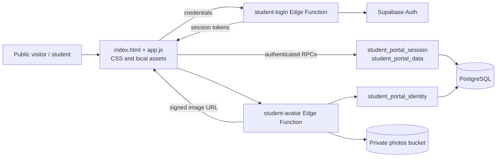

# Project Profile: Pioneers of Science School

Evidence-based technical dossier for future CV, portfolio, scholarship, and interview preparation. Claims below are limited to repository evidence or are explicitly marked as supplied by the project brief, unverified, or unknown.

## 1. Project identity

| Attribute | Evidence-based description |
| --- | --- |
| Project name | Pioneers of Science School website and student portal (Arabic brand: مدرسة رواد العلم الأولى للتعليم الحديث) |
| Repository | [`danya-musbah/Pioneers-School`](https://github.com/danya-musbah/Pioneers-School) |
| Category/domain | School information website and student information portal |
| Project summary | Arabic RTL public school landing page paired with a Supabase-backed student portal for personal enrollment, attendance, published results, fee summaries, and timetable information. |
| Problem addressed | The source presents school information separately from student-specific records; the portal is intended to give an authenticated student a personal view of selected school data. No measured operational problem or impact is documented. |
| Intended users | Public visitors and students with enabled linked accounts. Server endpoints additionally contain staff/admin operations, but no consuming management UI is included. |
| Objectives evidenced in source | Present the school; support student sign-in; load data scoped to the signed-in student; display relevant records in an Arabic RTL interface. |
| Scope boundaries | Public web content, student portal source, Supabase SQL schema/migrations and Edge Functions. A parent portal and full browser-based staff management product are not evidenced. |
| Development status | Source repository contains application, database migrations, tests, and functions. One current test fails; backend runtime/deployment is unverified. |
| Deployment status | Not provided / not verified. No production URL or deployment proof was inspected. |
| Start date, end date, duration | Not provided. Commit dates are not used as proof of project duration. |
| Project classification | Independently developed voluntary project, as specified in the task brief. The repository itself does not establish paid employment, a client contract, or company employment. |
| Author | Not provided as a CV identity in repository evidence. |

## 2. Individual contribution and ownership

The project brief identifies the covered work as an individual voluntary project completed independently by its author. Repository evidence supports describing the work as independent development across the following areas; it does not establish employer, client, team, or production-operations responsibilities.

- **Product/requirements analysis:** The code and documentation define public-site and student-portal flows, section navigation, student data fields, backend boundaries, and known implementation gaps.
- **Frontend engineering:** Native HTML/CSS/JavaScript modules implement the Arabic RTL landing page, authentication form, session flow, student views, responsive navigation, empty states, reduced-motion styles, and local artwork selection.
- **Backend/API engineering:** Deno Edge Functions implement student sign-in, photo signing, and separate staff/student account-management operations.
- **Database design:** Eight ordered SQL migrations describe school/student/academic/finance structures, helper functions, triggers, RLS policies, Storage buckets, seed data, and a student-specific RPC projection.
- **Integration:** The browser client uses Supabase Auth, RPCs, and Edge Functions; the avatar function integrates with private Supabase Storage.
- **Testing/debugging:** Node built-in tests exercise portal mapping, timetable edge cases, HTML escaping, and static SQL/CSS/function contracts. Current result is 8 passing and 1 failing test.
- **Technical documentation:** The repository includes setup and security notes; this profile and the accompanying SRS distinguish source presence from live verification.

Do not describe the project as paid employment, client delivery, a production deployment, or a team leadership role without additional author-provided evidence.

## 3. Technical stack and skills matrix

Confidence refers to evidence of use in this repository, not a general proficiency rating.

| Category | Technology/tool | Actual role | Evidence | Skill demonstrated / verification |
| --- | --- | --- | --- | --- |
| Programming language | JavaScript (ES modules) | Browser application and portal data mapping | [`js/app.js`](../js/app.js), [`js/data.js`](../js/data.js), [`js/student-portal-data.mjs`](../js/student-portal-data.mjs) | Direct implementation; high repository confidence |
| Markup | HTML5 | Static document shell and templates rendered by JS | [`index.html`](../index.html), `js/app.js` | Direct implementation; high |
| Styling | CSS | Design tokens, public page, portal, responsive states, reduced motion | [`css/tokens.css`](../css/tokens.css), [`css/styles.css`](../css/styles.css), [`css/student-portal.css`](../css/student-portal.css) | Direct implementation; high; one CSS test is failing |
| Server-side language | TypeScript | Supabase Deno Edge Function sources | [`supabase/functions/`](../supabase/functions/) | Direct source evidence; functions use `@ts-nocheck`, so type-check quality is not established |
| Database | PostgreSQL | Relational school information schema and stored procedures | [`supabase/migrations/001_extensions.sql`](../supabase/migrations/001_extensions.sql), migrations `002`–`008` | Extensive schema/source evidence; remote execution not verified |
| Authentication | Supabase Auth | Student credential validation/session, staff API authentication | [`student-login`](../supabase/functions/student-login/index.ts), `js/app.js` | Integration source exists; live operation unverified |
| Data API | Supabase PostgREST RPC | Session/data/identity projections and permission-aware operations | `student_portal_data`, `student_portal_session`, `student_portal_identity` | RPC boundary and client calls evidenced; live API unverified |
| Storage | Supabase Storage | Private photos/documents/attachments; signed student portrait URL | [`007_storage.sql`](../supabase/migrations/007_storage.sql), [`student-avatar`](../supabase/functions/student-avatar/index.ts) | Source-level integration; no live Storage test |
| Backend platform | Supabase Edge Functions / Deno | Authentication, signed avatar, administrative APIs | [`supabase/config.toml`](../supabase/config.toml), function sources | Configuration/code evidence; deployment unknown |
| Browser dependency | `@supabase/supabase-js` v2 | Browser and Edge Function Supabase client | [`js/supabase-client.js`](../js/supabase-client.js), function imports via esm.sh | Direct import evidence; loaded remotely, not pinned in a package manifest |
| Icons | Lucide 0.468.0 | UI icon system | [`index.html`](../index.html) | Versioned CDN script included |
| Typography | Tajawal via Google Fonts | Arabic browser font | [`index.html`](../index.html) | External stylesheet; offline behavior not verified |
| Testing | Node.js built-in `node:test` and `node:assert/strict` | Portal mapper and static-contract tests | [`tests/student-portal-data.test.mjs`](../tests/student-portal-data.test.mjs) | 8 pass / 1 fail in the current run |
| Local tooling | Python HTTP server | Serves static files for local browser testing | Existing setup instructions in [`README.md`](../README.md) | Command available in environment; not an application dependency |
| Version control | Git | Repository history and changes | Git repository metadata; repo URL above | Repository evidence only; no claim of a particular workflow |
| AI/ML | None evidenced | No AI or machine-learning implementation found in the inspected app/schema | Repository code and dependency structure | Do not list AI/ML skills for this project |
| Build/package tooling | None checked in | No `package.json`, lockfile, bundler, or build configuration at repository root | Repository root | Native ES modules and CDN imports; no build step evidenced |

## 4. Architecture and engineering decisions

### System shape

The browser app is a static client. The public page works without Supabase client configuration. Authenticated features depend on a Supabase project, schema migrations, Edge Functions, and linked student account data.

### Components and data flow

1. `index.html` loads the global and portal CSS, Lucide, and the JavaScript module entry.
2. `js/app.js` renders the public and authenticated views and manages page/session state.
3. `js/supabase-client.js` lazy-loads the Supabase JS v2 client from esm.sh using public browser configuration in `js/supabase-config.js`.
4. On login, the browser sends the student number and password to `student-login`. The function checks request shape and origin, applies a username-based attempt check, resolves the student's Auth email through a restricted RPC, and delegates password verification to Supabase Auth. It returns Auth session tokens without putting the service key in browser code.
5. After setting the session, the browser calls `student_portal_session()` and `student_portal_data()`. It compares the student identifiers from those responses before presenting portal content.
6. `008_student_portal_projection.sql` composes a JSON projection from the current student, enrollment, attendance, approved results, fee records, and class timetable.
7. `js/student-portal-data.mjs` maps fields, escapes text, assembles day/period groups, flags incomplete lessons, and creates a timetable grid.
8. For photos, `student_portal_identity()` returns identity/photo references for the authenticated student. `student-avatar` validates the bearer token and signs a same-project path from the private `photos` bucket for 600 seconds. The client retains local character artwork as a fallback.
9. `admin-user-management` and `student-app-access` expose separate staff/admin management actions. No browser UI in this repository invokes them.

### Database shape and boundaries

The eight migrations cover more than the student-facing pages. Core relationships include schools to staff profiles and student records; students to guardians and academic-year enrollments; enrollments to attendance/results/fees; classes to subjects and timetable entries; and users to role permissions and audit records. Monetary amounts, percentages, statuses, foreign keys, unique constraints, triggers, and RPC procedures encode some data invariants.

The student portal RPCs derive the current student from the authenticated identity and do not take a student ID from the browser. The result projection filters for approved/closed term results. The latest projection migration joins timetable entries through the class-subject and academic-year relations. The client does not directly query the student or finance tables.

### Decisions evidenced by implementation

- **Static native modules over a bundled framework:** No build or dependency manifest is present; modules and CSS are served directly.
- **RPC projection instead of broad browser queries for the portal:** Server-side SQL shapes and scopes the student response.
- **Student number as sign-in identifier:** A server-side RPC resolves the real Auth email from the enabled student account; the browser form uses the school-facing student number.
- **Private portrait path signing:** The browser does not select another student's ID or pass an arbitrary Storage path to the avatar endpoint.
- **Local artwork fallback:** Portal layout remains usable if a student photo is missing or cannot be signed.
- **Mapper separated from rendering:** `student-portal-data.mjs` is independently testable and contains timetable normalization and string escaping.
- **Broader schema than current UI:** Schema/function coverage includes administrative and school operations while the committed browser experience focuses on public information and the student portal.

These are observable design choices; the repository does not document the author's original rationale for them.

## 5. Implemented feature inventory

| Feature | Problem addressed and implemented behavior | Evidence and verification | Professional value |
| --- | --- | --- | --- |
| Arabic school landing page | Presents school identity, stages, portal overview, FAQ, and contact affordances in an RTL layout. | [`index.html`](../index.html), [`js/app.js`](../js/app.js), [`js/data.js`](../js/data.js); source verified, no browser test. | Internationalization-aware interface implementation and content-driven rendering. |
| Student sign-in and session setup | Accepts student number/password, calls server-side sign-in, applies returned Supabase tokens, restores session, handles expiration and logout. | [`js/app.js`](../js/app.js), [`student-login`](../supabase/functions/student-login/index.ts), [`js/supabase-client.js`](../js/supabase-client.js); live Auth unverified. | Authentication flow design, client/server separation, asynchronous state handling. |
| Identity-bound data projection | Checks account linkage and matches session identity to returned data before rendering. SQL selects a current eligible enrollment and projectable student fields. | [`008_student_portal_projection.sql`](../supabase/migrations/008_student_portal_projection.sql), [`002_functions.sql`](../supabase/migrations/002_functions.sql), `loadStudentPortal` in `js/app.js`; static tests exist. | Database/API boundary design and identity-aware data retrieval. |
| Profile and enrollment views | Maps student and current enrollment fields into grouped profile details and compact facts. | `renderPortalPageMarkup` in [`js/app.js`](../js/app.js), mapper in [`js/student-portal-data.mjs`](../js/student-portal-data.mjs); not browser-tested. | Schema-to-view data mapping and handling of optional fields. |
| Attendance summary/history | Builds counts and a percentage, and exposes recent records for the current enrollment. | SQL projection and portal UI; SQL returns at most 20 recent records. Live data/semantics unverified. | Relational aggregation and presentation of time-series school records. |
| Approved results | Exposes subject results only if the matching term result is approved or closed. | Results query in [`008_student_portal_projection.sql`](../supabase/migrations/008_student_portal_projection.sql); no dedicated runtime test. | Publication-state filtering and multi-table query composition. |
| Fee summary | Produces fee totals, payments, remaining balances, and status labels for the student's enrollment. | Fee projection in `008_student_portal_projection.sql`, tables in `001_extensions.sql`; live financial behavior unverified. | Aggregation across fee, installment, and payment data. |
| Timetable normalization | Joins class lessons to days and periods, maps subject/teacher/room, sorts periods, identifies today's agenda, and counts incomplete/unplaced rows. | [`js/student-portal-data.mjs`](../js/student-portal-data.mjs), SQL projection, [`student-portal-data.test.mjs`](../tests/student-portal-data.test.mjs); mapping tests pass. | Defensive data transformation, calendar/time concepts, and unit-testable module design. |
| Private portrait handling | Resolves a photo reference for the current identity, signs a private Storage object, restricts accepted URL origin, and uses local artwork on failure. | [`student-avatar`](../supabase/functions/student-avatar/index.ts), `student_portal_identity()`, `js/app.js`; static contract test passes, live test absent. | Server-side privileged access and graceful visual fallback design. |
| Responsive portal navigation | Offers wide-screen sidebar and compact fixed navigation, safe-area handling, section state, hash navigation, and browser history. | [`js/app.js`](../js/app.js), [`css/student-portal.css`](../css/student-portal.css); mobile navigation CSS test passes, real-device verification absent. | Responsive UI engineering and navigation/state synchronization. |
| Staff and student account APIs | Server functions include scoped list/create/update/delete/reset operations, student access management, credential issuance, and audit logging. | [`admin-user-management`](../supabase/functions/admin-user-management/index.ts), [`student-app-access`](../supabase/functions/student-app-access/index.ts); no browser client or runtime tests. | API authorization and multi-step account lifecycle design. Not a user-visible completed workflow in this repository. |

## 6. Engineering challenges and problem-solving evidence

These are implementation challenges visible from the code and test structure, not claimed personal debugging anecdotes.

### Mapping schedule records into a usable weekly view

- **Problem:** Timetable records depend on day numbers, period numbers, class, year, class-subject relation, and optional subject/room/teacher values. Incomplete or mismatched source rows should not be displayed as invented lessons.
- **Evidence of approach:** `008_student_portal_projection.sql` joins timetable entries with current class/subject/period/day references. `mapPortalData` groups days, orders lessons, records missing subjects and invalid placements; `buildTimetableGrid` maps periods to day cells.
- **Verification:** Tests check matching numbered cells, actual subject mapping, current-day agenda, and incomplete lesson behavior.
- **Remaining limit:** Tests use fixtures and static SQL assertions; they do not verify database execution against populated production-like records.

### Keeping authenticated student context consistent

- **Problem:** A portal must not trust a client-provided student identifier when returning personal information.
- **Evidence of approach:** SQL helper resolves the student from `auth.uid()`, portal data/identity RPCs accept no student ID, and the browser checks the session and projection student IDs before rendering.
- **Verification:** Static test asserts the projection calls the current student identity helper. No live RLS/RPC isolation test exists.
- **Remaining limit:** Deployed grants, policies, and schema version must be checked against an actual project.

### Handling untrusted projection text in HTML templates

- **Problem:** Database strings are inserted into HTML templates, so text must not be interpreted as markup.
- **Evidence of approach:** Mapper applies `escapeHTML` to mapped text fields before the renderer uses them.
- **Verification:** A unit test passes an HTML-like subject value and checks the escaped result.
- **Remaining limit:** The test covers mapped values; the full template surface does not have an automated rendering/security test.

### Optional private student photos

- **Problem:** A browser needs a portrait while the underlying Storage bucket is private and the caller should not select another student's record.
- **Evidence of approach:** Authenticated identity RPC resolves the current student; Edge Function validates the bearer and signs candidate paths in the photos bucket; browser restricts accepted URL origin and has local fallbacks.
- **Verification:** Static contract test passes. Signed URL issuance, expiry, access policy, and actual photo behavior are unverified live.

### Authentication lifecycle and failure states

- **Problem:** Auth, RPC, and renderer failures happen at separate stages; showing a partially validated portal would be unsafe and confusing.
- **Evidence of approach:** The browser has request timeouts, diagnostic stage labels, identity checks, failure messages, local session cleanup, restore handling, and explicit logout state.
- **Verification:** Source inspection only for this task; no automated browser/Auth integration test is present.
- **Remaining limit:** Error handling and session cleanup need end-to-end verification against a test project.

## 7. Professional skills and competencies

### Demonstrated by repository evidence

| Competency | Concrete evidence |
| --- | --- |
| Frontend application development | Static HTML entry point, modular JavaScript rendering, native form handling, page state, and multiple portal views |
| Responsive UI styling | Design tokens, mobile breakpoints, safe-area insets, navigation layouts, and reduced-motion rules |
| Arabic/RTL interface implementation | `lang="ar"`, `dir="rtl"`, Arabic UI content, Arabic-aware values, and right-to-left layout rules |
| Authentication integration | Supabase Auth client, student-number credential function, session restore, setSession, sign-out, and expired-session handling |
| API and client/server boundaries | Browser RPC/Edge Function calls with server-side resolution of student identity and privileged service-key usage in server functions |
| Relational data modeling | Student/enrollment/academic/attendance/grades/fees/timetable/permissions relations, constraints, and migration sequence |
| SQL function and policy implementation | PL/pgSQL RPCs, `SECURITY DEFINER` functions, RLS policies, explicit grants/revokes, and triggers |
| Data transformation | Defensive normalization, timetable grouping/sorting, optional field handling, and HTML escaping |
| Testing | Node built-in test suite with behavior tests and static contract checks |
| Technical communication | Setup/security notes and explicit implementation/deployment caveats in project documentation |

### Not established by available evidence

- Expertise or seniority level in any technology.
- Production incident response, uptime ownership, scalability, or performance engineering.
- Security certification, formal threat-model sign-off, penetration testing, or privacy compliance.
- Team leadership, stakeholder management, mentoring, or client delivery.
- User adoption, user counts, business outcomes, performance gains, or cost savings.
- A successful production release or live database deployment.

## 8. CV-Ready Achievement Statements

Use only if the author can confirm personal ownership and explain the implementation in an interview:

- Built an Arabic RTL school website and student portal with native HTML, CSS, and JavaScript ES modules, including responsive landing and student views.
- Implemented a Supabase student sign-in flow that resolves student-number credentials server-side and restores an authenticated browser session.
- Designed a student-specific PostgreSQL RPC projection that derives identity from the authenticated session and assembles enrollment, attendance, approved results, fees, and timetable data.
- Developed a JavaScript data-mapping module that normalizes portal responses, safely escapes displayed text, and converts timetable records into ordered weekly grids.
- Integrated private student portraits through a Deno Edge Function that validates the authenticated identity and returns a short-lived Supabase Storage URL with local artwork fallbacks.
- Added Node.js tests for timetable mapping, incomplete records, text escaping, gender normalization, and static SQL/Storage contracts.

No quantitative impact statement is justified by the available evidence. Future evidence could include measured browser performance, accessibility findings, number of verified test cases, and test-environment integration outcomes—but metrics must be collected rather than estimated.

## 9. Recommended CV classification

- **Section:** Independent Software Projects or Voluntary Software Development Projects.
- **Project title:** Pioneers of Science School — Arabic Student Portal.
- **Contribution label:** Independent Developer / Volunteer Software Developer (as applicable to the author's preferred wording).
- **CV summary:** Independently developed an Arabic RTL school website and student portal using native web technologies and Supabase. Implemented student authentication and an identity-scoped data path for school records, with responsive portal views and automated data-mapping tests.
- **Skills keywords:** JavaScript ES modules, HTML5, CSS, TypeScript, Deno, Supabase, PostgreSQL, SQL, Row Level Security, Supabase Auth, Edge Functions, REST/RPC integration, data modeling, responsive design, RTL, Node.js testing.
- **Relevant job families:** Frontend Developer, Junior/Mid-level Web Developer (based on role requirements, not a proficiency claim), Full-Stack Developer (web/Supabase-focused), Database/Application Developer, Software Engineering Intern.
- **Employer, client, dates:** Do not add an employer or client. Dates and duration are not provided.

## 10. Interview preparation

| Likely question | Evidence-based answer outline / what to verify |
| --- | --- |
| How is the application structured? | Static entry in `index.html`; `app.js` renders public/login/portal states; CSS is split into tokens, public styles, and portal styles; Supabase client is loaded lazily. Mention there is no checked-in build manifest. |
| Why does login use a student number while Supabase Auth uses email? | `student-login` resolves the student account's Auth email through a restricted RPC, then calls password sign-in. Explain that live account linking and deployment still need verification. |
| How does the data access boundary work? | `auth.uid()` maps to `student_app_accounts`; `student_portal_data()` derives current student identity and returns a JSON projection; browser checks the returned student IDs. State that source alone is not proof of production RLS. |
| How are results filtered? | The projection joins subject and term results and restricts term statuses to approved/closed. Be ready to confirm exact publication policy with the school/domain owner. |
| How is timetable data normalized? | `mapPortalData` validates weekday and positive period numbers, groups/sorts lessons, records missing/unplaced rows; grid builder maps ordered periods to days. Tests cover valid and incomplete examples. |
| How is portal text handled safely? | The mapper cleans and escapes strings before templates insert them. The test suite asserts one HTML-like subject is escaped. Avoid claiming a complete security audit. |
| How are private student photos handled? | Identity RPC resolves the current student's path references; avatar function checks bearer identity and signs a path in the private photo bucket; client enforces same project origin and keeps local artwork fallback. Live behavior remains unverified. |
| What security controls exist? | Server-side service key use, RPC identity binding, RLS/policy migrations, signed URLs, CORS checks, and function-level bearer/permission checks. Also discuss unresolved tenant/file-policy review and sensitive-profile minimization. |
| What did you test? | Node `node:test`: 8 passing, 1 failing at current run. Tests cover mapping, escaping, static SQL/function conditions, and CSS assertions; there is no live Auth/Postgres/Storage or browser end-to-end test. |
| What is the current known test failure? | The profile portrait CSS assertion expects `max-height: 100%`, but the current CSS sets `120%`. The mismatch was documented, not changed in this documentation-only task. |
| Which trade-offs or limitations remain? | No package/build system, external CDN dependencies, no education-link data, no management UI, one test failure, no verified deployment, unclear tenant/privacy/service-level requirements. |
| What would you improve next? | Fix or update the portrait CSS/test after deciding intended behavior; add browser and authorized Supabase integration tests; review sensitive field projection, RLS, storage isolation, and rate-limit semantics; define deployment and operational requirements. |

If an answer depends on production behavior, inspect a controlled test project first. Do not infer success from migrations or function source alone.

## 11. Evidence register

All paths below are repository-relative.

| File | What it demonstrates |
| --- | --- |
| [`index.html`](../index.html) | Arabic RTL page shell, CSS loading, external Lucide/Tajawal resources, and JavaScript entry point |
| [`js/app.js`](../js/app.js) | Public page, login, session lifecycle, portal pages, navigation, request timeouts, and portrait URL checks |
| [`js/data.js`](../js/data.js) | School profile content, public sections, and seven portal navigation cards |
| [`js/student-portal-data.mjs`](../js/student-portal-data.mjs) | Response mapping, HTML escaping, attendance/results/fees data shape, timetable grouping and grid |
| [`js/supabase-client.js`](../js/supabase-client.js) | Browser Supabase client loaded from esm.sh and rejection of service-role keys |
| `js/supabase-config.js` | Tracked browser configuration module containing public Supabase settings; do not copy its values into CV/docs |
| [`supabase/migrations/001_extensions.sql`](../supabase/migrations/001_extensions.sql) | Core school/student/academic/finance/timetable schema and account-link table |
| [`supabase/migrations/002_functions.sql`](../supabase/migrations/002_functions.sql) | Auth identity helpers, portal RPCs, login resolution, account and school logic |
| [`supabase/migrations/003_triggers.sql`](../supabase/migrations/003_triggers.sql) | Update, audit, status-guard and timetable-related triggers |
| [`supabase/migrations/004_rls.sql`](../supabase/migrations/004_rls.sql) | Table-level RLS policies; tenant scope and broad policies require deployment review |
| [`supabase/migrations/005_seed.sql`](../supabase/migrations/005_seed.sql) | Seeded permission/status/day/grade reference data and initial school setup |
| [`supabase/migrations/006_security_hardening.sql`](../supabase/migrations/006_security_hardening.sql) | Explicit function execute grants/revokes and security-related hardening |
| [`supabase/migrations/007_storage.sql`](../supabase/migrations/007_storage.sql) | Private Storage buckets and authenticated policies |
| [`supabase/migrations/008_student_portal_projection.sql`](../supabase/migrations/008_student_portal_projection.sql) | Current student data projection, attendance, published results, fees, and timetable |
| [`supabase/functions/student-login/index.ts`](../supabase/functions/student-login/index.ts) | Student-number sign-in, server-side identity resolution and attempt check |
| [`supabase/functions/student-avatar/index.ts`](../supabase/functions/student-avatar/index.ts) | Auth validation, path checks, and signed photo retrieval |
| [`supabase/functions/student-app-access/index.ts`](../supabase/functions/student-app-access/index.ts) | Staff-authorized student account state and credential workflows |
| [`supabase/functions/admin-user-management/index.ts`](../supabase/functions/admin-user-management/index.ts) | Staff/admin user-management API and permission checks |
| [`supabase/config.toml`](../supabase/config.toml) | Edge Function JWT-verification configuration |
| [`tests/student-portal-data.test.mjs`](../tests/student-portal-data.test.mjs) | Nine mapping/static contract/CSS tests; one currently fails |
| [`README.md`](../README.md) | Static setup instructions and repository-level implementation/security caveats |
| [`docs/srs/analysis-gaps.md`](srs/analysis-gaps.md) | Existing open questions about deployment, tenant policies, tests, guardian scope, and operations |

### Implemented, partial, unverified

- **Implemented in source:** Public landing page; student login/session/portal client; data mapper; portal views; SQL schema and projections; configured Edge Function source; local character artwork; Node tests.
- **Partially implemented:** Educational-links page with an empty data list; admin/student account APIs without a consuming UI in this repo; general school-system schema with only a limited visible student workflow.
- **Unverified:** Live login, live student isolation, live RPC execution, real result/fee/attendance correctness, signed Storage access, deployed RLS/policies, browser compatibility, accessibility, and production operations.
- **Known current test issue:** One CSS assertion failure: expected portrait max-height `100%`, source is `120%`.

### Claims not to use in a CV without new evidence

- Production deployment, production users, customer adoption, uptime, scale, or operating ownership.
- Compliance, certification, formal security approval, or penetration testing.
- Quantified performance or business results.
- Parent portal, notification/transport features, or a working staff-management web UI.
- AI/ML implementation.
- Paid employment, employer, client, team leadership, project dates, or duration.

### Missing information that would strengthen the profile

- Author's preferred name and exact contribution statement.
- Project start/completion dates if documented contemporaneously.
- Verified hosting/deployment destination and migration/function version.
- Authorized test environment and results for login, RLS isolation, RPC behavior, and Storage access.
- Agreed privacy scope for student profile fields and school/tenant boundary policy.
- Expected browser support, accessibility criteria, and measurable operational/performance goals.
- Decision on the existing failing portrait CSS assertion and confirmed UI behavior.
- Any externally measured outcomes; collect evidence rather than estimating.
