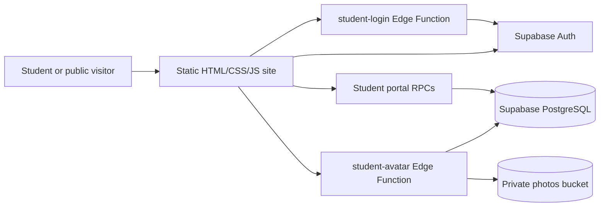

# Software Requirements Specification

## Document control

| Item | Value |
| --- | --- |
| System | Pioneers of Science School website and student portal |
| Repository | [danya-musbah/Pioneers-School](https://github.com/danya-musbah/Pioneers-School) |
| Document type | As-built requirements specification based on repository evidence |
| Revision | 1.0 |
| Last reviewed | 2026-10-22 |
| Deployment status | Not verified |

This document is structured in the spirit of ISO/IEC/IEEE 29148. It does not claim compliance, certification, or approval against that standard. Requirements describe behavior evidenced by the current repository; source presence does not establish successful operation in a deployed environment.

## 1. Purpose and scope

This specification records the observable scope of the repository: an Arabic right-to-left public school website, a student sign-in flow and portal, and supporting Supabase schema and server functions. It distinguishes the visible browser product from server-side functionality for which this repository has no management UI.

In scope:

- Public school information and contact content.
- Student authentication, session restoration, portal data retrieval, navigation, and sign-out.
- Portal display of enrollment/profile data, attendance, approved results, fee summaries, and timetable.
- Supabase Edge Functions, RPC interfaces, migrations, and security controls that support those flows.
- Tests and known verification limitations.

Out of scope or not established:

- A parent/guardian portal or a visible staff administration application.
- Production deployment, operational support, usage, performance, availability, and compliance claims.
- A guarantee that the deployed database matches the checked-in migrations.
- Business rules not encoded or documented in the repository.

## 2. Product overview and objectives

The product combines a static school landing page with an authenticated student experience. The browser is configured with public Supabase client settings. Student identity is resolved server-side from the authenticated session, and a Postgres projection returns a selected set of the current student's school data.

The repository also contains a broader school information system schema, including school configuration, user permissions, student records, enrollments, attendance, grades, finance, timetable, employee, document, and archive structures. The presence of those structures does not mean all corresponding workflows are available in the browser.

## 3. Terminology

| Term | Meaning in this specification |
| --- | --- |
| Student account | Supabase Auth identity linked to one student through `student_app_accounts` |
| Student portal | Authenticated browser area rendered by `js/app.js` |
| Projection RPC | `student_portal_data()`, which returns a JSON representation for the authenticated student's portal |
| Edge Function | Server-side Deno function under `supabase/functions/` |
| RLS | PostgreSQL Row Level Security |
| Evidence status | Repository implementation status, distinct from deployed/runtime verification |

## 4. Product perspective and context

The public page can render without a configured Supabase connection. Student sign-in requires configured browser client settings, the server functions, Auth, database functions, and linked student account data. The configured `student-app-access` and `admin-user-management` functions are separate management APIs and are not invoked by the checked-in browser application.

## 5. Stakeholders and user classes

| User class | Supported interaction | Evidence status |
| --- | --- | --- |
| Public visitor | Browse school information, FAQ, stages, and contact links | Implemented in browser source |
| Student with an enabled linked account | Sign in and view their own portal data | Client/server path implemented; live identity and data access unverified |
| Authorized school administrator/staff | Use server endpoints for account/user management if called by an authorized client | Server code and permissions exist; user interface and deployment are not present/verified |
| Parent or guardian | No separate browser sign-in path in this repository | Not implemented in the visible application |

The identity of project owners, school operators, and any real-world deployment stakeholders is not established by repository evidence.

## 6. Operating environment and constraints

- Browser application: static HTML, CSS, and JavaScript ES modules served over HTTP(S); no build step or dependency manifest is checked in.
- External browser dependencies: Lucide UMD script from unpkg, Tajawal font from Google Fonts, and the Supabase JS v2 module loaded from esm.sh.
- Backend: Supabase Auth, PostgreSQL/PostgREST, Storage, and Deno Edge Functions.
- Database setup is represented by migrations `001_extensions.sql` through `008_student_portal_projection.sql`.
- Local test command: `node --test tests\student-portal-data.test.mjs`.
- Local static serving instruction: `python -m http.server 8000`.
- The UI language is Arabic and the document direction is RTL.
- A browser network connection is required for the external resources and Supabase-backed features.

Minimum supported browser versions, availability objectives, backup/recovery objectives, data-retention policy, and production hosting requirements are not specified.

## 7. Assumptions and dependencies

1. A Supabase project with Auth, PostgreSQL, Storage, and Edge Functions is required for student portal access.
2. A student's Auth identity must be linked to an enabled, eligible student record.
3. Public browser configuration contains only a project URL and public anon/publishable key; service-role credentials are server-side only.
4. The listed migrations are the intended schema sequence, but their application to a remote project is not verified.
5. The school is responsible for the accuracy and authorization of student data entered into the database.
6. Availability of Google Fonts, unpkg, and esm.sh is an external dependency of the current browser implementation.

## 8. Functional requirements

Status convention: **Implemented in source** means code for the behavior is present. It does not mean the behavior has passed an end-to-end test against a live Supabase project.

| ID | Requirement | Status and evidence | Acceptance criteria |
| --- | --- | --- | --- |
| FR-001 | The system shall render a public Arabic RTL page presenting school information, educational stages, portal overview, FAQ, and contact links. | Implemented in source: [`index.html`](../index.html), `renderPublicLanding` and `schoolProfile` in [`js/app.js`](../js/app.js) and [`js/data.js`](../js/data.js). | With static files available, the page contains the public content and document direction is RTL. |
| FR-002 | The system shall provide a student-number/password sign-in form and reject submission when either value is empty. | Implemented in source: `renderLoginPage`/`submitLogin` in [`js/app.js`](../js/app.js). | Empty values produce an inline validation message and do not invoke the sign-in function. |
| FR-003 | The system shall submit student credentials to the `student-login` Edge Function and establish a Supabase Auth session from returned tokens. | Implemented in source: [`supabase/functions/student-login/index.ts`](../supabase/functions/student-login/index.ts), client flow in [`js/app.js`](../js/app.js). Live Auth behavior unverified. | A successful service response with access and refresh tokens is passed to `auth.setSession`; errors remain on the login flow. |
| FR-004 | The system shall validate that the authenticated session maps to an eligible student and that the data projection refers to the same student before rendering portal data. | Implemented in source: `loadStudentPortal` in [`js/app.js`](../js/app.js), identity helper in [`supabase/migrations/002_functions.sql`](../supabase/migrations/002_functions.sql). | Missing, unavailable, or mismatched identity prevents portal rendering. |
| FR-005 | The system shall show the signed-in student's available enrollment/profile information and omit fields with no value from rendered detail sections. | Implemented in source: `student_portal_data()` in [`supabase/migrations/008_student_portal_projection.sql`](../supabase/migrations/008_student_portal_projection.sql), mapper and profile renderer in [`js/student-portal-data.mjs`](../js/student-portal-data.mjs) and [`js/app.js`](../js/app.js). | Supplied profile values appear; absent values do not become fabricated profile values. |
| FR-006 | The system shall show attendance counts, a percentage when records exist, and recent attendance records. | Implemented in source: portal projection and mapper; projection limits returned history to 20 rows. Live data unverified. | With no records, the UI communicates that attendance is unavailable; with records, counts and recent entries render. |
| FR-007 | The system shall show subject results only when the associated term result is approved or closed. | Implemented in source: results query in [`supabase/migrations/008_student_portal_projection.sql`](../supabase/migrations/008_student_portal_projection.sql). | A result without an associated approved/closed term result is absent from the projection. |
| FR-008 | The system shall present fee records with total, paid, remaining, and status values returned by the database projection. | Implemented in source: fees projection in [`supabase/migrations/008_student_portal_projection.sql`](../supabase/migrations/008_student_portal_projection.sql), mapper and portal renderer. Live calculation behavior unverified. | Portal displays the projected fee amounts/status and an empty state when no fee rows are returned. |
| FR-009 | The system shall build a weekly timetable from available class lessons, order days and periods, and show the current day's agenda when possible. | Implemented in source: projection, `mapPortalData` and `buildTimetableGrid` in [`js/student-portal-data.mjs`](../js/student-portal-data.mjs). Unit tests cover mapping and incomplete rows. | Valid lesson rows map to period/day cells; invalid day/period data is not assigned to a fabricated cell. |
| FR-010 | The system shall expose seven student portal sections: summary, profile, attendance, results, fees, timetable, and educational links. | Implemented in source: `localPageCards` in [`js/data.js`](../js/data.js) and renderer in [`js/app.js`](../js/app.js). Educational links remain an empty list in the mapper. | Each section can be selected; the links section reports its empty/unconfigured state unless data support is added. |
| FR-011 | The system shall restore a valid saved session, route the signed-in student into the portal, and clear local session data on explicit sign-out or expiration handling. | Implemented in source: session functions in [`js/app.js`](../js/app.js). Live Auth behavior unverified. | A valid session is checked against the student account; explicit sign-out clears portal state and returns to the public page. |
| FR-012 | The system shall provide responsive portal navigation, including compact-screen navigation and browser history for portal pages. | Implemented in source: [`js/app.js`](../js/app.js), [`css/student-portal.css`](../css/student-portal.css). One CSS assertion is currently failing. | Selecting a section changes the active panel and location; back/forward selects a recognized portal page. |
| FR-013 | The system shall request an optional student portrait through an authenticated server function, without accepting a browser-supplied student ID or arbitrary remote photo URL. | Implemented in source: [`supabase/functions/student-avatar/index.ts`](../supabase/functions/student-avatar/index.ts), [`supabase/migrations/002_functions.sql`](../supabase/migrations/002_functions.sql), and [`js/app.js`](../js/app.js). Live Storage signing unverified. | Identity is resolved from the bearer session; only a URL from the configured Supabase project is accepted by the browser. |
| FR-014 | The system shall expose server-side functions for authorized staff user management and student app account management. | Implemented in source: [`supabase/functions/admin-user-management/index.ts`](../supabase/functions/admin-user-management/index.ts), [`supabase/functions/student-app-access/index.ts`](../supabase/functions/student-app-access/index.ts). No consuming UI is present. | Requests require a bearer session, active profile, school context, and the applicable permission checks in the function. Runtime behavior unverified. |

## 9. Non-functional requirements and constraints

These requirements record source-level properties rather than verified production service levels.

| ID | Requirement | Status and evidence | Verification/acceptance |
| --- | --- | --- | --- |
| NFR-001 | The browser shall not contain a Supabase service-role key; privileged service operations shall use server-side configuration. | Implemented by design in [`js/supabase-client.js`](../js/supabase-client.js) and Edge Functions. Deployment configuration unverified. | Inspect browser configuration for public-only settings; confirm deployed function secrets independently before release. |
| NFR-002 | Student projection RPCs shall resolve the student from the authenticated identity instead of a caller-supplied student ID. | Implemented in [`supabase/migrations/002_functions.sql`](../supabase/migrations/002_functions.sql) and [`supabase/migrations/008_student_portal_projection.sql`](../supabase/migrations/008_student_portal_projection.sql). Static contract test exists. | Tests assert identity helper usage; a live role/identity isolation test remains required. |
| NFR-003 | Text received from the portal projection shall be escaped before insertion into HTML templates. | Implemented by `safeText`/`escapeHTML` in [`js/student-portal-data.mjs`](../js/student-portal-data.mjs). | Existing test asserts escaping of an HTML-like subject string. |
| NFR-004 | The client shall bound portal requests with timeouts and provide user-facing failure states rather than rendering unvalidated portal data. | Implemented in [`js/app.js`](../js/app.js). | Source has timeout and error branches; no automated end-to-end timeout test is present. |
| NFR-005 | The UI shall include responsive layouts and reduced-motion styling. | Implemented in [`css/styles.css`](../css/styles.css), [`css/student-portal.css`](../css/student-portal.css), and [`css/tokens.css`](../css/tokens.css). | Source-based CSS assertions exist; browser/device and accessibility verification is not established. |
| NFR-006 | The product shall provide explicit response-time, availability, backup, recovery, and retention objectives before production claims are made. | Open / proposed release requirement; no measurable targets are documented. | Obtain approved targets and test them against the deployed service. |
| NFR-007 | External browser resources and Supabase services shall be treated as availability and privacy dependencies. | External URLs are present in [`index.html`](../index.html) and the browser client module. | Document approved external hosts and verify behavior when those resources are unavailable. |
| NFR-008 | Student personal data shall be limited to fields authorized for the student portal and handled according to the school's approved privacy policy. | Open / proposed privacy requirement; the projection includes direct identifiers and personal details, and policy approval is not in the repository. | Review/minimize fields in the projection and confirm authorization before production use. |

## 10. Use cases

### UC-001: Student signs in

- **Primary actor:** Student with an enabled linked account.
- **Preconditions:** Browser has valid public Supabase settings; student login function and database migrations are deployed; account is eligible and linked.
- **Main flow:**
  1. Student opens the login form.
  2. Student enters a student number and password.
  3. Browser invokes `student-login`.
  4. Server-side code checks request origin and input, applies a username-keyed attempt check, resolves the account email using a restricted RPC, and calls Supabase Auth.
  5. Browser applies the returned tokens to the Supabase client.
  6. Browser loads the portal session and data, verifies matching student identities, and renders the student home.
- **Alternative flows:** Empty input is rejected locally; invalid credentials, missing account mapping, service errors, identity mismatch, and timeouts produce an error state and do not expose portal data.
- **Outcome:** A validated student portal session is active, or the student remains outside the portal.
- **Verification:** The code path exists. Live login and full browser flow are unverified.

### UC-002: Student views school records

- **Primary actor:** Signed-in student.
- **Preconditions:** A valid Auth session maps to an eligible student with an active enrollment.
- **Main flow:**
  1. Browser requests the student session and portal projection RPCs.
  2. Database resolves the student from `auth.uid()` and selects the relevant enrollment and school records.
  3. Browser maps returned values into profile, attendance, results, fees, and timetable views.
  4. Student selects another portal section using the sidebar or compact navigation.
- **Alternative flows:** Missing records produce empty states; malformed timetable lessons are not placed in fabricated cells; a request/data error prevents the portal from being accepted as valid.
- **Outcome:** The student sees the available projected records.
- **Verification:** Mapping and static SQL contract tests exist; database execution and real data are unverified.

### UC-003: Student portrait is loaded

- **Primary actor:** Signed-in student.
- **Preconditions:** Valid bearer session; identity RPC returns an allowed photo reference.
- **Main flow:** Browser invokes `student-avatar`; the function validates the bearer identity, obtains the current student's identity without a caller-supplied student ID, resolves a path within the `photos` bucket, and requests a signed URL with a 600-second lifetime.
- **Alternative flows:** Missing photo, invalid path, or signing error leaves a local illustration fallback.
- **Outcome:** A same-project signed photo URL is used when available; otherwise the fallback remains.
- **Verification:** Static source assertions exist; live signed URL use is unverified.

### UC-004: Authorized staff manages accounts

- **Primary actor:** Staff/admin with required permissions.
- **Preconditions:** `student-app-access` or `admin-user-management` is deployed and called by an authorized client.
- **Main flow:** Function validates bearer identity and active profile, derives school context and permissions, validates the requested operation, then calls Auth/RPC/database operations and records audit data where implemented.
- **Alternative flows:** Invalid session, missing permission, invalid input, operation failure, or audit failure returns an error or per-record failure.
- **Outcome:** A server-side account/user operation may be completed.
- **Verification:** Function source exists; no client UI or live integration test is present in this repository.

## 11. Business rules evidenced in source

1. Student number is used as the visible student login identifier; the real Auth email is resolved server-side.
2. Student account eligibility requires a linked Auth identity, enabled account, enabled student login status (`active` or `reset_required`), non-withdrawn student, and non-archived student record.
3. A portal request resolves the current student from the authenticated identity; it does not accept a student ID from the browser.
4. Student result rows are included only when the related term result is `approved` or `closed`.
5. The student projection returns up to 20 recent attendance entries.
6. Portal educational links currently map to an empty array; no link-management implementation is evidenced.
7. Guardian login status is guarded in database triggers, and no separate guardian login UI is present.
8. The production behavior and interpretation of local source policies must be confirmed against the deployed database.

## 12. Data requirements

| Entity | Purpose and relationships evidenced |
| --- | --- |
| `schools`, `school_settings` | School identity, configuration, and currency/settings |
| `profiles`, `permissions`, `user_permissions` | Staff/admin identity and permission model |
| `students` | Student identity and personal details |
| `student_app_accounts` | Link from a student to a Supabase Auth user, enabled state, and credential-delivery metadata |
| `student_enrollments` | Link student to academic year, grade, and optional class |
| `academic_years`, `academic_stages`, `school_grades`, `classes`, `subjects`, `class_subjects` | Academic structure and class/subject relationships |
| `student_attendance`, `attendance_statuses` | Attendance records and status semantics |
| `subject_results`, `term_results`, `grade_bands` | Assessment results and publication/approval status |
| `student_fees`, `installments`, `fee_types`, `payments` | Fee obligations, paid amounts, and payment records |
| `timetable_entries`, `timetable_periods`, `week_days` | Class schedule, periods, and weekday labels |
| `audit_logs` | Administrative and system change audit records |

The schema also includes employee, payroll, documents, archives, notifications, and other modules that are outside the visible student portal's current feature set.

## 13. External interfaces and integrations

| Interface | Purpose | Evidence / status |
| --- | --- | --- |
| Supabase Auth | Authenticate student and maintain browser session | Auth client and Edge Function source; remote behavior unverified |
| PostgREST RPC | Session/data/identity projection and management operations | SQL functions and JavaScript RPC calls |
| Supabase Storage | Store private school photos/documents and sign student photo URL | `007_storage.sql`, avatar function; no live check |
| Supabase Edge Functions | Credential sign-in, signed portrait, staff/user and student access management | Four configured functions |
| Google Fonts | Load Tajawal font | External stylesheet in `index.html` |
| unpkg/Lucide | Load icon library | External script in `index.html` |
| esm.sh | Load Supabase JS v2 for browser and Edge Functions | Imports in client and function source |

## 14. Authentication, authorization, privacy, and security

- Student sign-in is implemented by `student-login`; the `service_role` key is read by server functions and must remain server-side.
- `student_portal_data()` and `student_portal_identity()` derive the student from the current authenticated identity. Migration `006_security_hardening.sql` restricts sensitive RPC execute permissions, while `008_student_portal_projection.sql` provides the current portal projection.
- `student-avatar` checks the caller token and signs only a path derived from the authenticated student's identity. The browser further restricts accepted image URLs to the configured Supabase project origin.
- Admin functions check the bearer identity, active profile, school scope, and permissions in code. `supabase/config.toml` disables platform JWT verification for three functions; those functions implement their own checks. CORS alone is not authorization.
- Public anon/publishable keys do not replace RLS. Database policies and deployed grants must be inspected in the target project.
- The student projection includes sensitive personal data, including a national identifier, religion, birth details, address, and family names. The repository does not establish an approved privacy policy or justification for each field.
- Static analysis of migrations shows broad active-user policies in some general tables and broad authenticated file-read policies. Verify tenant/object-level access and least privilege against the deployed schema before release.
- The login attempt RPC uses a username-derived hash and a 15-minute window; repository analysis notes no IP-based key and that `student-login` does not call `record_login_failure`. This should not be presented as a comprehensive abuse-prevention control.
- No independent security certification, penetration test, privacy review, or production security assessment is documented.

## 15. Error handling and validation

- Login form rejects missing student number/password before network invocation.
- Edge Functions check HTTP method, request shape, environment configuration, CORS origin, bearer token where applicable, and operation-specific values.
- Portal calls have a 15-second timeout; selected cleanup calls use a shorter timeout.
- Portal identity mismatch and failed/missing data block portal rendering.
- Portal mapper escapes string values before template insertion and detects missing/unplaced timetable data.
- Student photo errors fall back to local artwork.
- Some Edge Functions log generic diagnostic messages; full provider errors are not consistently exposed to the browser.
- The repository has no automated integration tests for function error behavior or live database constraints.

## 16. Acceptance criteria

The following criteria summarize the current testable code paths, not release approval:

1. Static serving of `index.html` renders an Arabic RTL public page.
2. An empty login submission cannot proceed to the Edge Function.
3. A portal is rendered only after session/student identity and projection identity agree.
4. An approved/closed term result can enter the student projection; other result statuses cannot.
5. Database text is escaped by the mapper before it is interpolated into templates.
6. Incomplete timetable rows are reported as unplaced instead of appearing in an invented day/period cell.
7. A student photo is accepted only as a signed same-project URL; otherwise a local fallback remains.
8. Portal section navigation uses the supported page list and reflects the selected page in browser history.
9. The current repository test suite should pass before release; at this review, it fails one profile portrait CSS assertion (see §17).
10. End-to-end login, database isolation, data publication, and signed Storage access must be verified against an authorized test project before claiming live operation.

## 17. Known limitations and unresolved questions

- Current test run: 8 passed, 1 failed. Test 9 expects `max-height: 100%` in the profile portrait rule; current `css/student-portal.css` sets `max-height: 120%`. No source or test fix is included in this documentation task.
- No production deployment, successful live login, live RPC result, or signed Storage URL is verified.
- Educational links are not configured by the mapper. No student-facing admin or staff portal is present.
- Multi-school/tenant boundaries and broad RLS/Storage policies require review in the deployed database.
- Determine which sensitive profile fields are authorized and necessary for student display.
- Confirm intended policy for guardian access, account reset and temporary credential delivery.
- Confirm exact business rules for attendance percentages, result calculations, fees, and enrollment selection with the domain owner.
- Define minimum browser support, accessibility expectations, performance/availability targets, backup/recovery objectives, and data-retention requirements.
- The migrations are local repository files; deployment state and database catalog are unknown.

## 18. Traceability

| Requirement | Main implementation | Test evidence |
| --- | --- | --- |
| FR-001 | `index.html`, `js/app.js`, `js/data.js` | No public-page automated test |
| FR-002–FR-004 | `js/app.js`, `student-login`, `002_functions.sql` | No live auth/identity test |
| FR-005–FR-009 | `008_student_portal_projection.sql`, `js/student-portal-data.mjs`, `js/app.js` | Tests cover timetable mapping, escaping, gender and static projection contracts; no live DB test |
| FR-010–FR-012 | `js/data.js`, `js/app.js`, `css/student-portal.css` | CSS mobile-navigation assertions pass; profile portrait CSS assertion fails |
| FR-013 | `student-avatar`, `002_functions.sql`, `007_storage.sql` | Static signed-URL contract assertion passes |
| FR-014 | `admin-user-management`, `student-app-access`, `006_security_hardening.sql` | No automated Edge Function runtime tests |
| NFR-001–NFR-002 | `js/supabase-client.js`, `006_security_hardening.sql`, `008_student_portal_projection.sql` | Static SQL/endpoint checks only |
| NFR-003 | `js/student-portal-data.mjs` | Escaping unit test passes |
| NFR-004–NFR-008 | `js/app.js`, CSS, migrations, `index.html` | Partial source assertions; no deployed SLO, privacy, or cross-browser verification |
